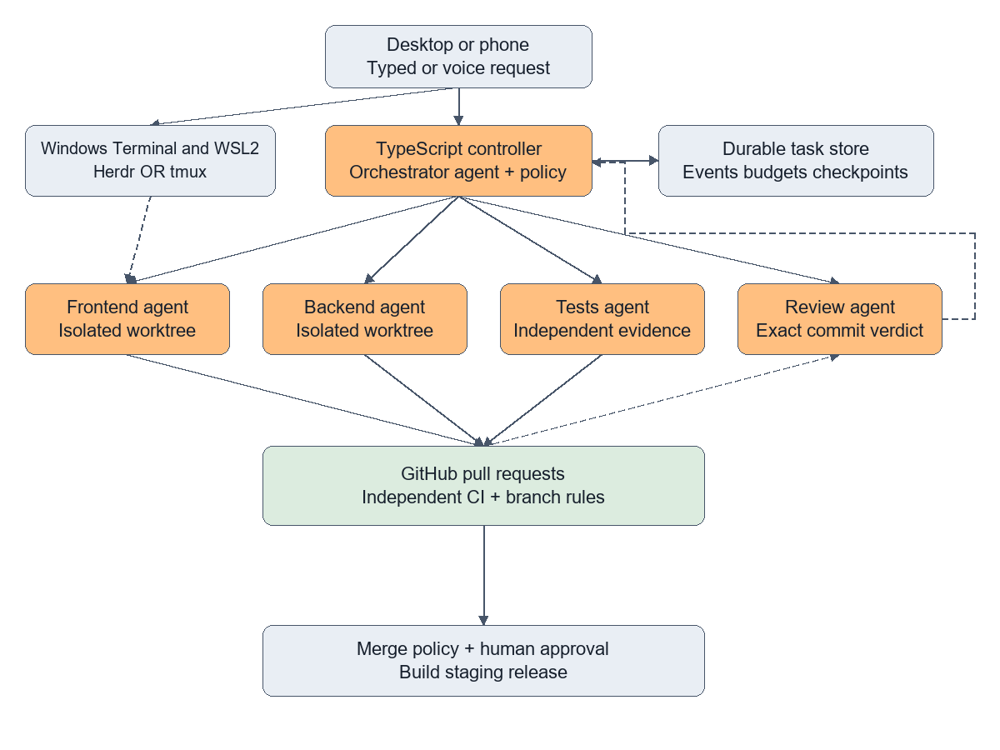
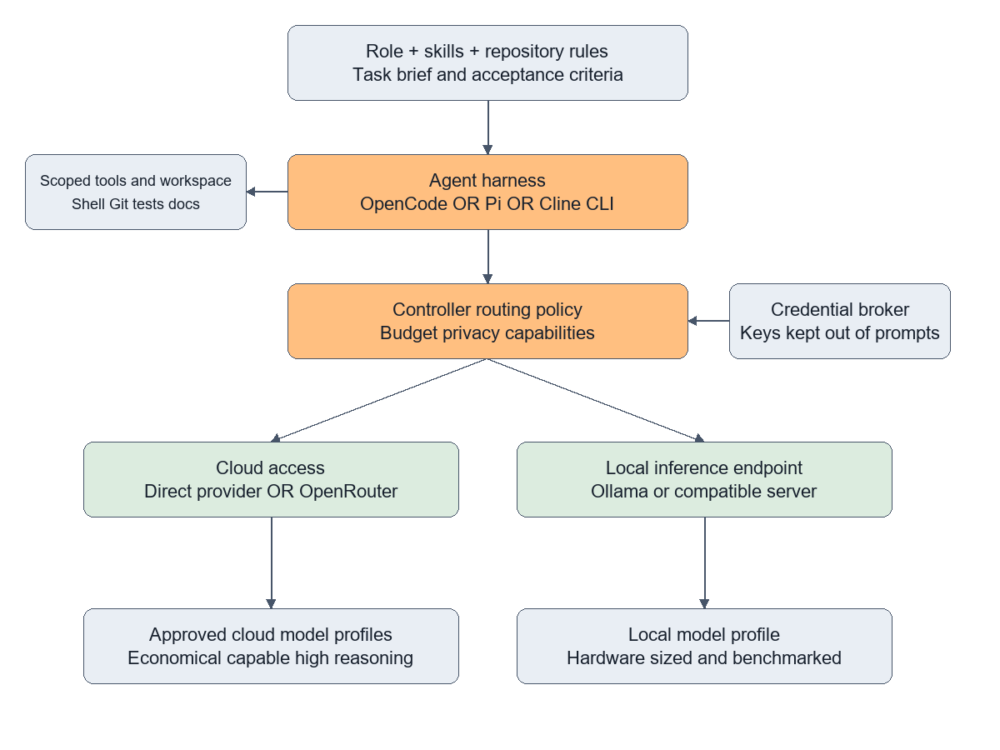
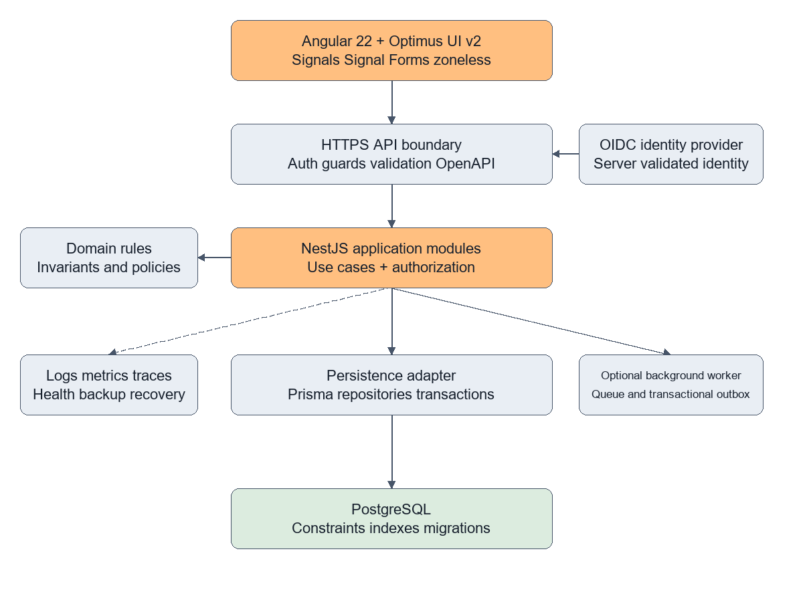

# Local multi agent development architecture

Detailed proposal for Windows 11 Pro with WSL2, Angular, NestJS and PostgreSQL

Prepared 3 October 2026. This is an architecture and implementation proposal, not an installed or tested system. Product capabilities below are linked to primary documentation. Decisions about workflow, security boundaries, module structure and rollout are recommendations.

## 1 Recommended direction

Your diagram captures a useful separation: a visible team of coding agents, a configurable agent and model layer, and GitHub as the collaboration point. Keep those ideas. Add a durable task controller, isolated workspaces, enforceable permissions, continuous integration, and a release process. Those additions turn a collection of terminal sessions into a development workflow you can inspect, recover and trust.

Use Windows Terminal as the desktop entry point and Ubuntu under WSL2 as the development environment. Use Herdr for agent visibility if its integrations behave reliably with the chosen agent. Keep tmux as an interchangeable fallback. Start with one coding-agent implementation across all five roles, preferably OpenCode for a comparatively integrated configuration experience, or Pi if a small extensible harness and a custom controller are your priority. The faint label in the supplied image appears to say “pi dev”; Pi is the likely intended tool, but that identification remains an assumption.

Build a small TypeScript controller around the chosen harness. The orchestrator agent proposes plans and assignments; deterministic controller code owns task transitions, worktree creation, process execution, credentials, budgets, retries and merge eligibility. Begin with SQLite for local task state. The application database remains PostgreSQL and is separate from this control database.

For the application, use Angular 22 with signals, stable Signal Forms, zoneless operation and Optimus UI v2. Use Node.js 24 LTS, NestJS, a PostgreSQL persistence adapter such as Prisma, and a modular monolith organized around business capabilities. Add Fastify as Nest’s HTTP adapter if plugin compatibility and measurements support it. Robustness comes from authorization, invariants, migrations, observability and tested recovery, rather than the number of frameworks or architectural patterns.

The essential operating rule is: agents may propose and implement changes, while code and repository policies enforce what they may change, spend, approve and merge.

## 2 Corrections and tool identities

| Item | What it actually does | Place in the proposal |
| --- | --- | --- |
| Herdr | Agent-aware terminal multiplexer with CLI and socket interfaces | Visibility and terminal session adapter |
| tmux | Agent-agnostic terminal multiplexer | Stable Linux and WSL fallback |
| Windows Terminal | Windows terminal application hosting shells | Desktop entry point |
| Ghostty | Terminal emulator | Optional terminal choice on supported platforms; not an agent |
| Pi | Coding-agent toolkit with CLI, RPC and TypeScript SDK surfaces | Lightweight agent harness candidate |
| OpenCode | Coding agent with configurable agents, permissions and models | Default harness candidate |
| Cline | Coding agent with a CLI as well as editor-oriented workflows | Alternative after integration testing |
| OpenRouter | Hosted gateway to model providers | Optional cloud model access |
| LiteLLM proxy | Self-hosted model gateway | Optional centralized routing and accounting |
| Ollama | Local model serving software | Local inference endpoint |
| Git | Version control system | Branches, commits and worktrees |
| GitHub | Hosted collaboration and CI platform | Pull requests, checks and branch rules |

Herdr can identify agent states and expose ways for agents to interact through its API. That capability is useful, but a terminal state such as idle does not prove that a task is complete. Record task completion separately, including its commit, test results and output. [Herdr documentation](https://herdr.dev/docs/)

OpenCode and OpenRouter occupy different layers. You can use OpenCode with direct provider credentials, OpenRouter, or a supported local endpoint. Pi offers programmable integration surfaces; implementing orchestration and enforcement around it is your responsibility. Cline now documents a CLI, so it should not be dismissed as editor-only. [OpenCode](https://opencode.ai/docs/), [Pi](https://github.com/earendil-works/pi), [Cline CLI](https://docs.cline.bot/usage/cli-overview), [OpenRouter](https://openrouter.ai/docs/quickstart), [Ghostty](https://ghostty.org/docs/about)

The library you remembered is Optimus UI. Its documentation describes an MIT community continuation of PrimeNG and maps Optimus v2 to Angular v22. The statement that PrimeNG has no free option is too broad: PrimeUI has a free Community license for eligible users, while older MIT releases remain available. A free proprietary license and an MIT license are different choices. Select Optimus if preserving an open source component foundation is important, then verify the exact package license and dependency tree you adopt. [Optimus UI](https://optimus.openng.org/), [Compatibility](https://optimus.openng.org/migration/update), [PrimeUI Community terms](https://primeui.dev/licenses/community)

## 3 Revised generic workflow



Solid arrows in this diagram show commands, assignments and change delivery. Dashed arrows show observation and feedback. The model layer is expanded in the next diagram. GitHub and cloud inference are external services; the controller and workers run locally under WSL2.

The user submits a typed instruction through the desktop interface or an authenticated remote client. Voice input is an optional transcription adapter that creates the same task request. It is not a separate authority path. Before execution, show the resulting scope, acceptance criteria and any consequential action clearly.

The orchestrator produces a plan with dependencies. The controller validates that plan, creates a task record, assigns a worker, supplies an approved model profile and starts a job in its own workspace. Every worker reports structured progress as well as producing visible terminal output. Herdr or tmux displays the sessions; the controller also offers a status command or dashboard based on durable events.

Frontend and backend agents normally open implementation PRs. The test agent can open a PR for missing tests, or test an implementation PR without creating another one. The review agent normally submits review findings or a verdict against an exact commit rather than opening a PR. The orchestrator normally coordinates; it should create a PR only when it performs an explicit integration or documentation task. Thus “all agents create PRs” should become “every code change enters through a PR, and every agent records its relevant evidence.”

GitHub runs independent CI checks. The reviewer inspects the diff, task criteria and CI evidence, then requests changes or reports approval. A policy service decides whether all requirements for merging are satisfied. Initially, you approve merges and production releases. Later, allow automatic merges for tightly defined low-risk changes that satisfy the same repository rules.

## 4 Terminal and machine layout

Use this physical layout: Windows 11 Pro → Windows Terminal → WSL2 Ubuntu → Herdr or tmux → agent processes and the controller. Install Git, Node, package tooling, the coding harness and the multiplexer in Linux. Keep the repository and its worktrees under a Linux path such as ~/src/product and ~/worktrees/product. Microsoft recommends storing Linux-tool projects in the Linux filesystem for performance. Avoid running five package installations and builds against a repository on /mnt/c. [WSL filesystems](https://learn.microsoft.com/en-us/windows/wsl/filesystems)

Windows can still host the terminal, browser, editor and device drivers. Choose one container arrangement: Docker Desktop with WSL integration, or a Linux container engine inside WSL. Do not operate two competing engines accidentally. PostgreSQL and development dependencies can run in containers; bind application connections to local interfaces and use named volumes for data.

Herdr is the preferred interface when you value its agent status display. tmux is the simplest independent fallback inside WSL or a native Linux machine; it does not provide business task status itself. A small controller status pane supplies that missing information. Avoid nesting Herdr inside tmux by default, because competing keybindings and attach behavior make recovery harder. Test either adapter against the same workflow. [tmux](https://github.com/tmux/tmux), [Herdr](https://github.com/herdrdev/herdr)

Use five named role views, but run only the number of active jobs your hardware and provider limits can support. Frontend and backend work can often overlap after an API contract is agreed. Full integration tests usually depend on both. Review should inspect the resulting change rather than an unfinished moving target.

Detaching a multiplexer does not protect jobs from Windows sleep, WSL shutdown, reboot or loss of network access. Persist tasks and agent checkpoints, supervise the controller with a user service where supported, and reconcile jobs on startup. For reliable unattended execution, move the same controller and worker layout to an always-on Linux host later. A phone can reach it over SSH or a private authenticated connection. Do not expose shell or orchestration endpoints directly to the public internet.

## 5 Agent harness choice and portability

| Candidate | Best reason to choose it | Main integration work |
| --- | --- | --- |
| OpenCode | Existing agent, permission and provider configuration | Verify machine-readable execution, cancellation and session resume |
| Pi | Small programmable harness and RPC or SDK integration | Build the controller, policy layer and role conventions |
| Cline CLI | Existing Cline skills or workflows | Verify unattended approval behavior and structured output |

Choose one harness for the first complete workflow. Mixing three harnesses immediately multiplies differences in permission semantics, context files, events, model APIs and session recovery. Run a qualification task before deciding: each harness must implement a small change, stream structured progress, stop on command, survive a controlled interruption, resume or restart predictably, and obey restricted tools. Evaluate the resulting code and operational behavior.

Define your own narrow adapter interface: startTask, sendInput, cancelTask, getStatus, resumeTask when supported, and collectResult. Each task receives a role profile, workspace path, model profile, permitted tools and a bounded task brief. Adapter output includes run ID, event stream, exit status and artifact references. This is a proposed interface, not a claim that these names are native commands in any product.

Do not promise transparent model or harness replacement. Tool calling, context windows, reasoning controls and continuation formats vary. Convert a completed checkpoint into a new brief when switching harnesses or providers. Preserve the task identity and evidence, rather than attempting to copy hidden reasoning or incompatible internal state.

## 6 Durable orchestration and agent responsibilities

The controller is a small service, separate from the business application. Its orchestrator agent is an advisory planning component. A durable record contains the user objective, acceptance criteria, task graph, assigned role, workspace, base commit, branch, current head commit, model profile, attempt, budget, status and output references. SQLite is sufficient for a single-machine controller if writes are serialized correctly. Use a server database when multiple hosts must coordinate.

| Role | Responsibility | Boundaries |
| --- | --- | --- |
| Orchestrator | Break down work, maintain dependencies, request fixes, summarize outcomes | Cannot waive CI or approve its own code |
| Frontend | Angular features, UI integration, accessibility and browser behavior | Own assigned frontend paths and contracts |
| Backend | Nest modules, authorization, persistence and migrations | No production credentials or direct production migration |
| Tests | Independent acceptance, regression, integration and adversarial tests | Cannot weaken acceptance criteria to obtain a pass |
| Review | Inspect exact commits and report actionable findings | No changes to the implementation under review |

Use states such as queued, ready, running, blocked, awaiting review, changes requested, awaiting merge, completed, failed and cancelled. “Idle” describes a process waiting for work; “completed” describes a task that satisfied its exit conditions. A crashed process must never be interpreted as a successful task.

Workers claim tasks with leases and heartbeat periodically. If a lease expires, mark the run interrupted and reconcile its process, worktree and remote PR before retrying. The same task attempt should not create duplicate branches or PRs. Use idempotency identifiers for dispatch and publication, bounded exponential backoff for transient failures, and a maximum repair-attempt count. After repeated failures, report the actual blocker to the user with the existing evidence.

Use dependencies rather than asking all agents to work immediately. An agreed OpenAPI contract can unblock frontend work with mocks while backend implementation proceeds. Assign schema migrations and shared lockfiles to one owner at a time. The orchestrator requests coordination when scopes overlap; a file allowlist in a prompt is only guidance unless a sandbox or broker enforces it.

## 7 Git workspaces and review policy

Create one branch and one Git worktree per coding task. A worktree isolates checked-out files, but shares Git metadata with the repository and does not isolate operating-system permissions, ports or databases. Use separate container workspaces or OS accounts when stronger boundaries are necessary. Each job needs its own temporary files, service ports and test database or schema. All jobs must be able to run concurrently without resetting another job’s database.

Keep PRs small enough to review. Include the objective, before and after behavior, design decisions, test evidence, contract changes, migration implications and known limitations. Draft PRs are useful for visibility; mark them ready only when the declared checks have passed. Prefer independent changes with an explicit integration order over a long chain of dependent PRs.

The reviewer must not be the author, and should preferably use a different strong model profile for security-sensitive work. Independent prompting and a different model reduce correlated mistakes but do not establish correctness. Bind the review to the head commit SHA. Any new commit invalidates the prior evidence until relevant checks and review are refreshed.

GitHub does not turn an orchestrator’s opinion into an enforced rule. Configure protected branches or rulesets to require the applicable checks and approval conditions, restrict direct pushes, and remove bypass rights from worker credentials. A PR author cannot supply the independent approval for their own PR. If multiple local processes share one GitHub identity, their role labels do not create independent GitHub reviewers. Use distinct narrowly scoped automation identities where appropriate, or use the AI review as a required check and keep the human approval separate. Validate the organization’s plan and policy support. [GitHub protected branches](https://docs.github.com/en/repositories/configuring-branches-and-merges-in-your-repository/managing-protected-branches/about-protected-branches)

Only a dedicated merge component should possess merge capability. It reads the exact current PR state and required checks before acting. The review agent can report approval or changes requested, while the orchestrator decides the next assignment. Neither should be able to override policy merely because a model says the change is safe.

## 8 Skills configuration and context

Use three levels of version-controlled guidance: organization-wide development standards, repository-specific architecture and commands, and role-specific instructions. Add task-specific context last. Skills provide workflows and examples; they do not confer authority or credentials. Define precedence explicitly and translate it into the files supported by each harness rather than assuming every agent interprets the same file identically.

Keep a proposed repository layout such as docs/architecture, docs/decisions, automation/roles, automation/skills, automation/policies and automation/tasks. Use AGENTS.md or the equivalent supported by your harness for concise repository guidance. Maintain a single source for shared rules and generate harness-specific variants so they do not drift.

Every worker brief should contain the objective, acceptance criteria, scope, base commit, dependencies, contract version, allowed actions, verification commands, budget and stopping conditions. Require a result containing changed files, head commit, PR reference, completed checks and unresolved issues. Store large logs as artifacts, not in every agent’s prompt.

Give the frontend role Angular and UI skills; the backend role API, authorization and database skills; the test role independent acceptance and fault-testing skills; the review role a security and architecture checklist; and the orchestrator planning and dependency skills. This changes expertise and context. It does not require a different underlying model for every role.

Repository files, PR descriptions, dependency documentation and tool output are untrusted input. They must not be able to override controller policy, request additional credentials or silently expand the task. Protect the shared rule files and require explicit review for modifications. Keep secrets out of prompts, terminal history, patches and artifacts.

## 9 Model routing and cost control



The agent proposes a capability need; the controller selects an approved model profile. A routing policy or gateway enforces provider allowlists, privacy constraints, spend limits and fallback rules. The harness then calls a compatible endpoint. Do not let an unconstrained worker choose any expensive model merely by naming it.

Start with three profiles: economical for bounded mechanical changes, capable for ordinary implementation, and high-reasoning for planning, difficult diagnosis and review. These are configurable aliases, not fixed provider brands. Benchmark candidate models on your actual Angular and Nest tasks, measuring accepted results, total spend, retries, latency and repair effort. A cheap model that needs repeated correction may cost more overall.

For the first implementation, direct provider connections plus Ollama are enough if the controller can enforce accounting. Add OpenRouter when its provider access and policies are useful. Add LiteLLM when you need one self-hosted gateway for multiple compatible endpoints, centrally enforced budgets or consistent usage logs. Avoid chaining gateways unless a concrete requirement justifies the extra failure point. Verify the exact tool-calling features each route supports. [Ollama](https://docs.ollama.com/), [LiteLLM proxy](https://docs.litellm.ai/docs/proxy/quick_start)

Consumer subscriptions, agent subscriptions and API billing are separate entitlements. Never assume a paid chat subscription provides a general API key or that its limits apply to API calls. Provider-native subscription login may work in a particular harness; verify that provider’s documented authentication and permitted usage. Local inference still costs hardware, electricity, memory and maintenance. Free hosted routes can have quotas or availability restrictions.

Set per-task and daily budgets, token limits, concurrency limits, maximum tool rounds and execution timeouts. Reserve sufficient budget for verification and review. Model escalation should occur at a checkpoint after the controller records why the first attempt failed. On provider failure, retry transient errors within a limit; then use an explicitly approved fallback. If privacy policy requires local-only execution, cloud fallback is forbidden.

Hardware determines the useful local model size. Record GPU model, VRAM, RAM, driver support and measured tokens per second before choosing a model. Context and tool calls can consume significant memory beyond model weights. Run one local inference queue initially rather than loading five large models simultaneously. An idle role can remain logically available without keeping its model resident.

Switching models should produce a handoff summary with task scope, current commit, completed checks and unresolved problems. Start a new session if compatibility requires it. Tool privileges remain unchanged when model capability changes. Keep routing credentials in a broker or gateway where possible, and block workers from bypassing the approved routes if you require enforceable budgets.

## 10 Software creation and delivery lifecycle

The generic agent workflow needs a separate product lifecycle. A development task begins with a problem statement and acceptance examples, proceeds through architecture and API or UI contracts, then implementation, independent validation, review, integration, staging and release. Production observations and failures feed new tasks.

1. Define the feature and its nonfunctional requirements: users, permissions, data sensitivity, expected load and recovery expectations.
2. Agree on domain language, API behavior, UI states, database changes and measurable acceptance criteria. Record significant choices in short architecture decision records.
3. Create a dependency graph. Give frontend and backend agents independently actionable scopes; give the test agent acceptance examples before implementation is finished.
4. Implement in isolated worktrees. Run focused local checks and publish draft PRs for visibility.
5. Run independent CI and review against exact commits. Send failures back to the responsible role with reproducible evidence.
6. Integrate in dependency order and verify the combined result. Build an immutable artifact from the merged revision.
7. Deploy that artifact to staging, apply tested migration steps, run smoke tests and authorize production promotion according to policy.
8. Monitor the release, keep a rollback or roll-forward plan, and close the task only when its stated completion conditions are met.

Do not make “tests are green” the entire definition of done. Include authorization boundaries, accessibility where relevant, migration safety, observability, documentation and operational readiness. Conversely, do not require every possible architectural pattern for every task. A static UI copy change and a financial transaction endpoint should have different required evidence.

## 11 Application architecture



The recommended starting point is a modular monolith: one NestJS application with explicit business modules and one PostgreSQL database, plus a separate background worker only when required. Modules own their business rules and tables. They interact through explicit application interfaces or events. This gives you manageable deployment and transaction behavior while preserving boundaries that can later support extraction into services.

Angular talks to the API over HTTPS. It never accesses PostgreSQL directly. The API authenticates the caller, checks authorization for the requested operation and specific resource, validates the request, executes the use case and maps the result to a documented response. Domain rules do not live in controllers, and ORM records do not become public DTOs automatically.

NestJS is the framework you remembered. Its dependency injection, modules, controllers and guards will feel familiar coming from .NET. Fastify is a Node HTTP framework and can serve as Nest’s adapter; it is unrelated to the Python FastAPI framework despite the similar name. Nest also supports its default Express adapter. Select the adapter based on ecosystem compatibility and measured behavior. [NestJS](https://docs.nestjs.com/), [Nest Fastify adapter](https://docs.nestjs.com/techniques/performance)

Use a supported Node LTS release rather than selecting Current solely because it is newer. Node’s release page lists v24 as LTS and v26 as Current at the time of this proposal. Angular 22’s published compatibility table accepts the v24 line starting at 24.15.0. Pin a compatible patch and resolve Nest, ORM, build tooling and TypeScript peer dependencies together. Do not force one TypeScript compiler version across unrelated packages if their support ranges differ. [Node releases](https://nodejs.org/en/about/previous-releases), [Angular compatibility](https://angular.dev/reference/versions)

## 12 Angular and Optimus frontend

Use standalone components, feature-based directories, lazy routes and explicit typed boundaries. Keep writable state private to a feature service or component; expose derived state with computed signals. Prefer immutable updates and make loading, empty, error, success and permission-denied states explicit. Use effects for necessary interaction with external systems, rather than duplicating state that computed can derive.

Angular’s current API marks the core form function stable since v22.0. Use Signal Forms for new forms on the chosen Angular 22 baseline. Confirm the status of less common APIs separately and test third-party controls: the stability of the core form function does not prove every custom control integration works. [Signal Forms API](https://angular.dev/api/forms/signals/form), [Signal Forms overview](https://angular.dev/guide/forms/signals/overview)

Zoneless is the default in Angular v21 and later. Verify that neither application nor test configuration reintroduces ZoneJS. Prefer signal-driven template state and components compatible with OnPush. However, “change detection entirely with signals” is too restrictive: Angular also responds to template listeners, input updates, AsyncPipe and explicit notifications. RxJS remains useful for cancellation, event streams and asynchronous composition. Convert to signals at intentional boundaries instead of banning observables. [Angular zoneless behavior](https://angular.dev/guide/zoneless)

Choose Optimus UI v2 for Angular 22, pin the components and companion packages coherently, and record its license. Place high-value recurring controls behind a thin application UI layer, especially tables, dialogs, date input and form controls. Do not wrap every component unnecessarily. Build a compatibility suite covering keyboard navigation, focus restoration, signal-form validation, disabled state, asynchronous options, overlay behavior and zoneless updates. Treat accessibility claims from a library as inputs to testing, not proof that your application is accessible.

Generate a typed Angular client from the API’s OpenAPI document and verify contract changes in CI. Client-side validation improves interaction; server validation remains mandatory. Avoid storing persistent bearer credentials in localStorage where a same-origin secure session architecture is available. Keep secrets and authorization decisions on the server. Use SSR only when search indexing or performance requirements justify its extra complexity.

## 13 NestJS backend and persistence

Organize each business module into transport, application, domain and infrastructure concerns. Controllers translate HTTP; application services coordinate use cases and transactions; domain code enforces invariants; infrastructure implements persistence and external integrations. Keep this separation proportionate: simple reference-data operations do not need a large class hierarchy.

Use dependency inversion where it isolates meaningful behavior or external dependencies. Introduce repository ports for aggregates and substantial domain operations. Avoid generic repositories that merely rename every ORM method. Map ORM objects to domain or response models at boundaries. Keep framework decorators and database-specific concerns out of domain logic when practical.

Prisma is a reasonable default data adapter between Nest and PostgreSQL because it offers generated query types and migration tooling. Drizzle is a SQL-oriented alternative when closer control over SQL is the priority; TypeORM is another established option. Choose one per module boundary rather than layering several ORMs. Prisma officially supports PostgreSQL. [Prisma PostgreSQL support](https://www.prisma.io/docs/orm/v7/core-concepts/supported-databases/postgresql)

Regardless of adapter, review the SQL behavior. Enforce unique, foreign-key and check constraints in the database. Index actual access paths, inspect slow queries, cap pagination, and avoid N+1 queries. Treat decimal amounts and dates deliberately; do not assume JavaScript numbers or timezone-naive timestamps preserve business meaning. PostgreSQL 18 is a supported baseline candidate, subject to hosting and extension support. Pin and update its patch version through reviewed maintenance. [PostgreSQL version policy](https://www.postgresql.org/support/versioning/)

Use transactions around business invariants, and select isolation or locking when concurrent writes could violate them. Prefer optimistic concurrency for ordinary editable records, with a version or equivalent concurrency token and a documented conflict response. Use idempotency keys for retryable operations that create meaningful side effects. Time out external calls and avoid keeping database transactions open while waiting for a remote service.

Review migration SQL and test it against representative data. Use expand and contract changes for rolling deployments: add compatible schema, deploy compatible code, backfill safely, then remove old schema later. Production migrations run through a dedicated release identity, never from application startup or a worker agent with unrestricted credentials. A code rollback does not automatically reverse data changes; define a separate data recovery or roll-forward plan.

## 14 API security and operational design

Use an established OpenID Connect identity provider rather than building password management casually. For a first-party browser application, prefer a same-origin deployment with secure HttpOnly cookies and a server-managed session or BFF when appropriate. Apply CSRF protection to state-changing cookie-authenticated requests. If the application requires bearer tokens, use a supported OAuth flow, validate issuer, audience and expiry on the server, and define rotation and revocation behavior.

Authentication identifies the caller; authorization decides what they can do. Enforce authorization in every relevant use case, including access to the specific object. Client route guards are only interface controls. In a multi-tenant application, tenant context comes from validated identity or server-side membership, and database queries must include the tenant boundary. Add negative tests for cross-tenant and horizontal access attempts.

Validate input shape, size, types and permitted fields at runtime. TypeScript does not validate network requests. If using Nest ValidationPipe, configure its whitelist and rejection behavior deliberately; equivalent schema validation is also possible. Separate DTOs for create, update and output so internal fields cannot be assigned accidentally. Parameterize queries; allowlist sort fields; bound file uploads, page sizes and request bodies. Avoid exposing stack traces or database errors to clients.

Apply TLS, secure headers, a narrow CORS policy when cross-origin access is needed, request timeouts and abuse controls. Trust proxy headers only from known infrastructure. Keep application, migration and read-only database identities distinct. Limit outbound requests where user input can influence URLs to reduce SSRF risk. OWASP provides the baseline REST security guidance; the architecture still needs a threat model for the actual product. [OWASP REST security](https://cheatsheetseries.owasp.org/cheatsheets/REST_Security_Cheat_Sheet.html)

Publish OpenAPI contracts and consistent error responses with safe details and a correlation identifier. Document pagination, filtering, concurrency and idempotency semantics. Use additive API changes where possible; version breaking changes and publish a retirement policy rather than duplicating APIs without a plan.

Record structured logs, metrics and traces, with secrets and sensitive payloads removed. Track request latency, error rate, database pool pressure, job queue age and external dependency failures. Add readiness and liveness checks with different purposes. A dependency outage may make an instance unready without requiring an endless restart loop.

Run stateless API replicas when load requires them and externalize session state if necessary. Size database pools across all replicas, not per instance in isolation. Add caching only after identifying a measurable bottleneck and specify invalidation behavior. Use background queues for durable work and design consumers for duplicate delivery. The transactional outbox pattern is useful when a committed database change must reliably cause an external event; it should not be added to every CRUD operation.

Define service objectives, load assumptions, recovery point and recovery time targets before production. Test backups and restoration. Secure scaling includes recovery behavior, not only successful requests per second.

## 15 Verification and release evidence

| Check | Purpose | Typical owner |
| --- | --- | --- |
| Formatting lint and type checks | Consistent code and static correctness | CI |
| Domain unit tests | Business rules and boundary cases | Implementer and tests role |
| PostgreSQL integration tests | Transactions constraints queries and migrations | Tests role and CI |
| API contract checks | Compatibility between API and generated client | CI |
| Browser acceptance tests | User journeys signal forms and zoneless UI | Tests role |
| Authorization tests | Forbidden resource and tenant access | Tests role and reviewer |
| Dependency and secret scanning | Supply chain exposure and accidental credentials | CI |
| Load and recovery tests | Capacity and operational behavior | Scheduled or release checks |

Use a real disposable PostgreSQL instance for database behavior. SQLite is not a substitute for PostgreSQL transaction or SQL tests. Playwright is a suitable browser acceptance tool; select frontend and backend unit runners that are supported by the pinned frameworks. Avoid “coverage percentage passed” as the only quality goal: critical failure paths matter more than line counts.

The tests role should derive important cases from acceptance criteria, not merely reproduce implementation logic. Add cases for duplicates, retries, unauthorized access, invalid input, concurrency and downstream failure where relevant. A review finding needs a location, reason, consequence and reproducible example or test when possible.

Release from a merged commit, producing an immutable versioned artifact. Promote the same artifact through staging and production. Protect deployment environments, separate credentials from build jobs, and record migration and rollback instructions. Reassess existing CI evidence when combining independently passing PRs; an integration test failure belongs to the combined revision.

## 16 Permission boundaries for the agent system

Prompt instructions are helpful but insufficient for containing tool execution. All processes running under one WSL user can potentially access that user’s files and environment. A worker with a broad shell cannot be considered restricted solely because its role file says “frontend only.” Use containers, OS identities, scoped mounts and a credential broker when strict enforcement is required.

Workers receive disposable workspace access and development-only secrets. The review process gets repository read access and scoped review or check publication, while a separate executor runs untrusted tests in a sandbox. The merge component alone has merge rights. Deployment credentials are held by the release system. The model gateway keeps provider keys away from ordinary workers when the selected harness integration allows it.

Untrusted PR code can execute through tests, package lifecycle scripts or build tools. Do not run it in a privileged controller environment. CI jobs for untrusted contributions must not receive production secrets. If you introduce MCP tools, allowlist servers and individual capabilities; adding a tool interface is not a reason to grant unrestricted access.

Require deliberate human authorization for production deployment, destructive data operations, large spend changes and changes to the security or approval policy. Routine development, testing and correction can remain autonomous within the established task boundaries. The controller should record approvals against the concrete operation and revision they authorize.

## 17 Failure handling and observability

| Failure | Required behavior |
| --- | --- |
| Agent exits unexpectedly | Preserve worktree and logs; reconcile task before retry |
| Model quota or outage | Bounded retry then approved fallback or blocked state |
| WSL shutdown | Restore task state and inspect unfinished side effects |
| Conflicting edits | Stop overlapping work and assign an integration owner |
| Review rejects a change | Create a bounded repair task tied to the findings |
| New commit after approval | Refresh relevant checks and review |
| Local resource exhaustion | Queue jobs and limit builds or local inference |
| Budget exhausted | Preserve checkpoint and stop additional model calls |
| Migration fails | Stop promotion and follow tested recovery instructions |

The controller dashboard should show task ID, role, state, last activity, elapsed time, attempt, model, estimated cost, workspace, branch, head commit, PR and blocker. Herdr’s live terminal display complements this durable view. Keep a chronological event log so you can reconstruct what happened even if a pane is no longer visible.

Use both process health and task progress. A live process that has produced no meaningful progress can be stuck; an idle process with a completed task can be healthy. Preserve artifacts before cleaning up worktrees. Retention and cleanup are explicit controller policies, not ad hoc agent decisions.

## 18 Implementation sequence

Phase one establishes the environment and proves one complete task. Configure WSL storage, tool versions, a repository, one harness and one multiplexer. Have a single worker produce a small change, PR, independent CI result and human-reviewed merge. Acceptance means you can interrupt the run, retain the work and understand the result without reading the entire terminal history.

Phase two adds durable coordination. Implement the task record, event log, adapter interface, leases, worktree lifecycle and cancellation. Add frontend and backend roles, then the tests and review roles. Acceptance means simultaneous jobs do not share writable source files, ports or test data, and no duplicate dispatch produces duplicate PRs.

Phase three adds provider and policy controls. Establish model profiles, a benchmark set, spend tracking and permitted fallbacks. Add a gateway only if needed. Prove that a worker cannot merge, access deployment credentials or route confidential work to an unapproved provider. Acceptance means budgets and approvals are enforced by the controller and external service permissions.

Phase four establishes the reusable application foundation. Create the Angular and Optimus compatibility suite, Nest module template, OpenAPI client generation, PostgreSQL migrations, authentication integration, authorization tests and CI. Build one complete vertical feature with failure cases, rather than generating a large application before the foundation is exercised.

Phase five proves operational readiness. Add staging deployment, release promotion, load measurements, backup restoration, alerting and rollback or roll-forward procedures. Permit automatic merging only for a defined class of changes after enough runs demonstrate that its checks and recovery are reliable.

This sequence reduces setup risk without treating the target application as an MVP. Security boundaries, database invariants and acceptance criteria start in the first vertical feature; later phases extend the operating system around it.

## 19 Example task contract and repository structure

The following is an illustrative controller contract. It is not a ready-to-load configuration for OpenCode, Pi, Cline or Herdr.

```yaml
task_id: customer-list-frontend
role: frontend
objective: Implement customer search and pagination
base_commit: <verified commit SHA>
dependencies: [customer-api-contract]
workspace: <isolated Linux worktree path>
scope: [apps/web/src/app/features/customers]
model_profile: capable
privacy: approved-cloud-or-local
limits:
  max_attempts: 3
  max_duration_minutes: 45
  max_cost: <chosen currency and amount>
acceptance:
  - Search cancels or ignores outdated responses
  - Empty loading error and forbidden states are visible
  - Keyboard navigation and pagination work
  - No ZoneJS dependency is introduced
result:
  required: [head_commit, pr_reference, checks, unresolved_issues]
```

A suitable monorepo has apps/web, apps/api and optionally apps/worker; packages/api-client for generated client code; packages/contracts only for intentional cross-boundary schemas; and separate domain modules inside the backend. Add docs/decisions, infrastructure, and automation for the agent control configuration. Share contracts and deliberate utilities, not ORM models or every frontend and backend type.

Use pnpm workspaces as a straightforward foundation and Nx if task scheduling, boundary enforcement and caching warrant it. Either can work; select based on measured repository needs. Keep the controller isolated from the deployed application, even if its source is stored in the same repository.

Before implementation, settle the actual hardware, provider accounts, expected application load, identity provider, hosting target, tenant model and data sensitivity. These determine local model feasibility and production policies. They do not prevent adopting the generic workflow above.

## 20 Sources and version maintenance

Product facts were checked against the linked primary documentation for this proposal. Versions and license terms can change. Resolve exact patches and peer dependencies during setup, pin them in lockfiles and container references, and review upgrades through the same PR workflow. A moving “latest” tag is not a reproducible foundation.

The three diagrams are supplied separately as editable diagrams.net pages. Their boxes describe the recommended architecture; they do not imply that every connection is available without implementing an adapter or controller.

The linked references throughout this document cover Herdr, tmux, Pi, OpenCode, Cline, Ghostty, OpenRouter, LiteLLM, Ollama, WSL storage, Angular releases and APIs, Optimus compatibility, PrimeUI licensing, NestJS, Prisma, PostgreSQL, Node.js, GitHub branch protection and OWASP REST security. Operational policies and module choices are the recommendations of this proposal.
